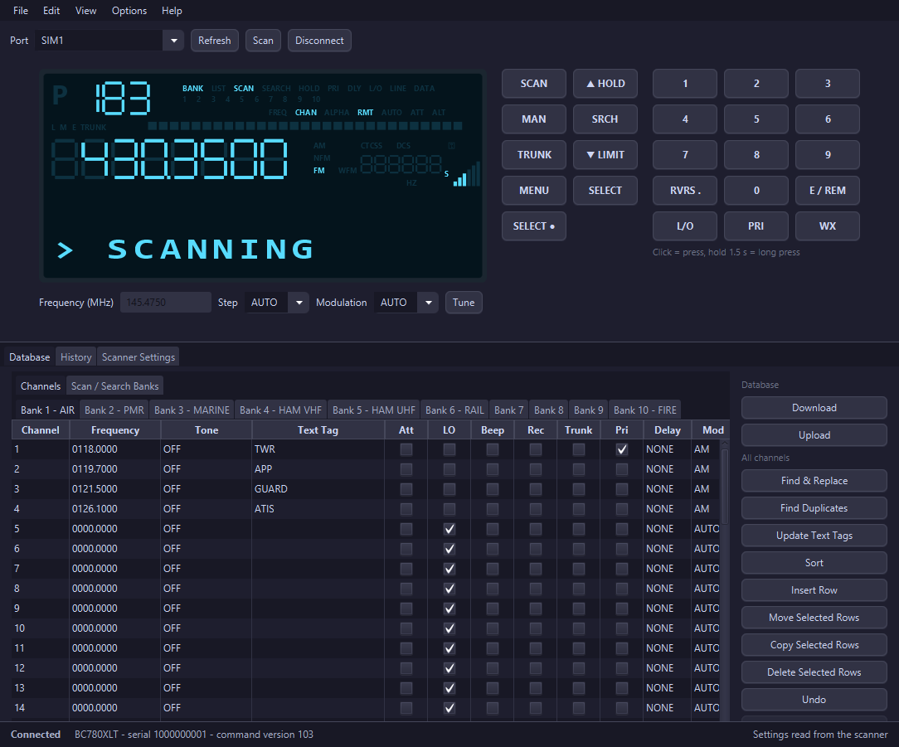
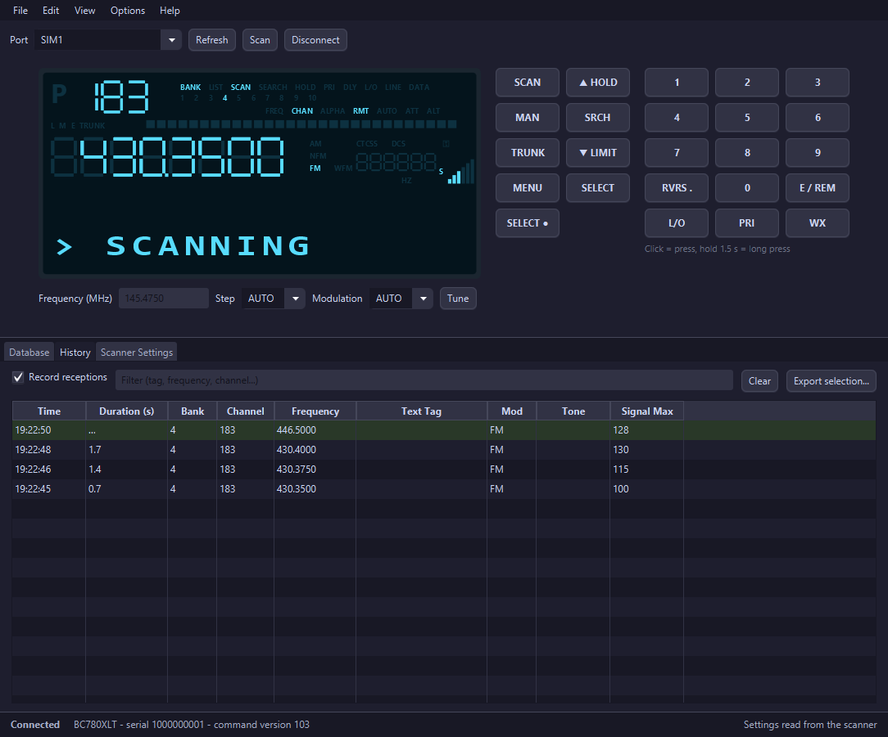
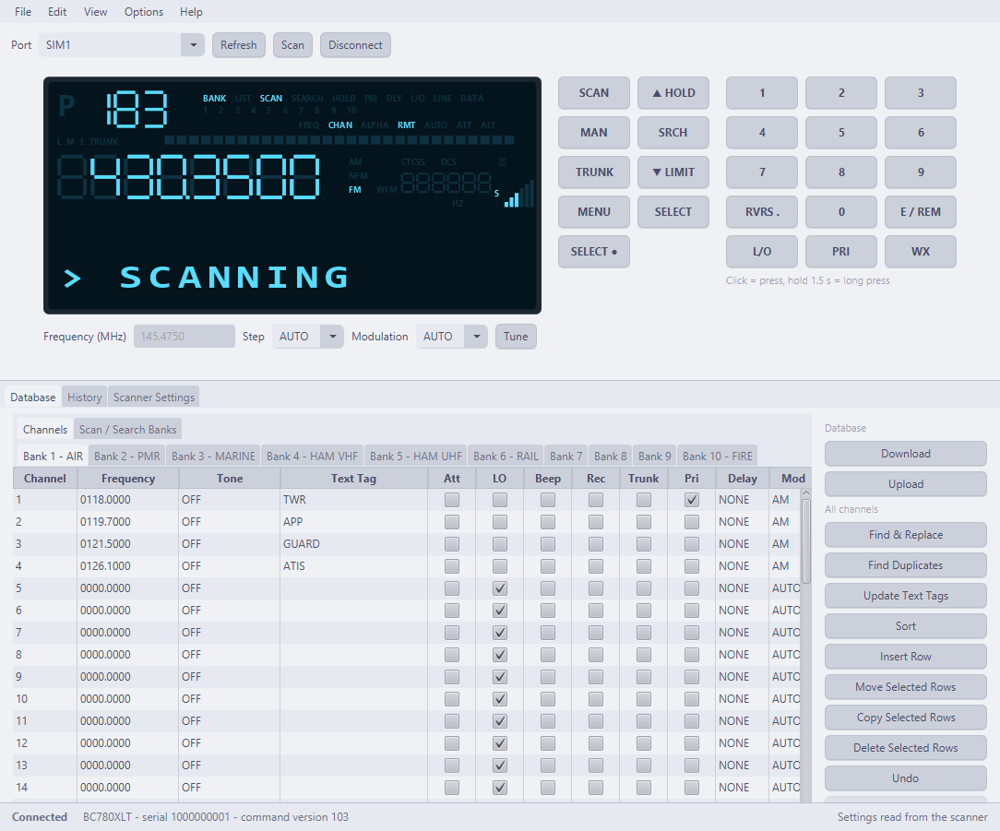
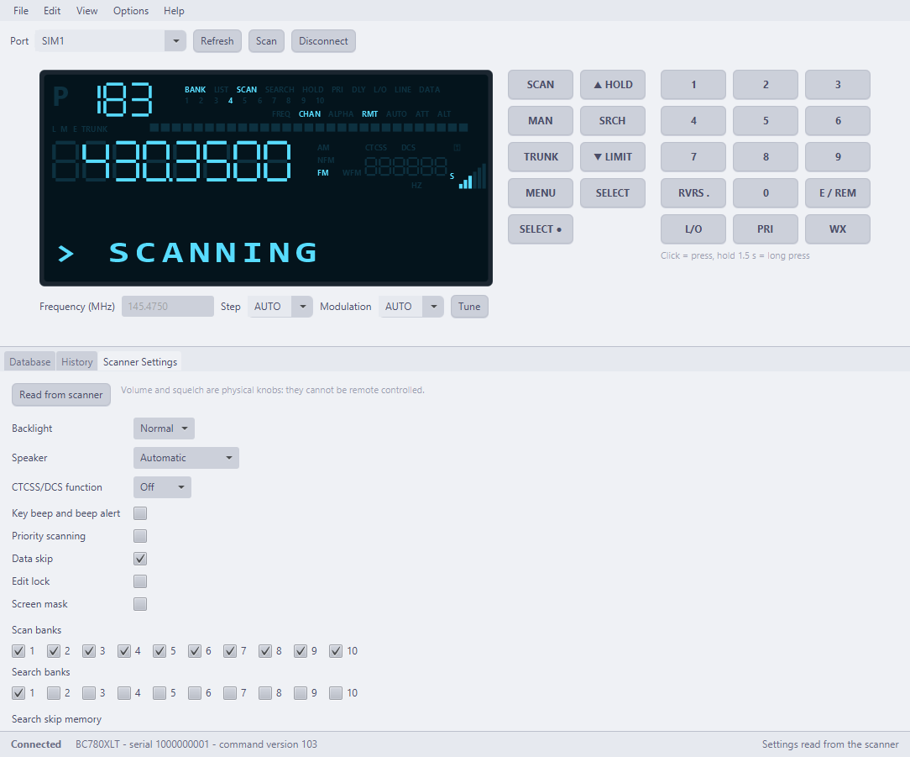

# UBC780XLT Companion

Remote control and programming software for the **Uniden BC780XLT** scanner, written in Java 21 and OpenJFX, for Windows, Linux and macOS. 

> **A word before you start.** This software was written with the help of AI (Claude, by Anthropic), under human direction and tested on a real scanner. It is probably not perfect. But good hardware should not end up in a drawer just because the software that drives it is no longer maintained, or has become paid. I hope this project helps some of you keep using older equipment today, and I welcome every bug report, correction that makes it better. Any email or QSL is welcome if you use this software, thanks.



## End user

### Requirements

- A computer running **Windows, Linux or macOS**. The installers include their own Java runtime: nothing else to install.
- To control a real scanner: a **Uniden BC780XLT** and a serial or USB-serial cable (with its driver). On Linux, your user must belong to the `dialout` group.

### Quick start

1. Connect the scanner to the computer and, on the scanner, switch to remote mode (the `RMT` icon lights).
2. Install the application from the [Releases](../../releases) page (`.msi` for Windows, `.deb` for Linux, `.dmg` for macOS; or the `.zip`, which needs Java 21 and is started with `run.bat` / `run.sh`), or run it from the sources (see [Build and deployment](#build-and-deployment)).
3. Press **Scan** (the application tries every port at every speed and selects the scanner), then **Connect**.

## Features

- **Remote control**: a faithful, scalable replica of the scanner LCD (seven-segment channel, frequency and CTCSS/DCS, every icon with flashing, signal meter, bank numbers, the two text lines), all the keys of the front panel (click = press, hold 1.5 s = long press) and **Frequency / Tune** (type a frequency, pick a step and a modulation).
- **Programming**: edit the 10 **Scan Banks**, 10 **Search Banks** and 500 **Channels** in tables, then **Download** them from the scanner or **Upload** them to it. Validation as you type, copy/paste, insert/delete/move/copy rows, sort, find & replace, find duplicates, unlimited undo/redo.
- **Files**: save and open the programming as a native **XLSX** workbook (sheets `SCAN`, `SEARCH`, `CHANNELS`).
- **History**: what the scanner receives (time, duration, channel, frequency, tag, modulation, tone, strongest signal), live and in one CSV file per day, with an XLSX export.
- **Scanner settings**: backlight, beep, priority, data skip, speaker, edit lock, screen mask, CTCSS/DCS function, active scan and search banks, search skip memory.
- **Connection**: a **Scan** button that finds the scanner (any port, any speed), automatic baud rate detection, automatic reconnection when the cable is unplugged.
- Catppuccin **Latte** and **Mocha** themes, English and French.

Not supported: Trunk banks and ID lists, audio recording, turning the VFO knob, volume and squelch (these are physical controls the remote protocol cannot reach).

| History | Light theme (Latte) |
|---------|---------------------|
|  |  |

| Scanner settings (Latte) |
|--------------------------|
|  |

## Using the application

**Remote control.** The display, the keypad and the frequency box form a panel that stays at the top of the window, whatever tab is open, so the display can be watched while tables are edited. **View > Show remote panel** hides it to give the tabs the whole window (the choice is remembered). The display is refreshed with the `LCD` command every `pollingMs`. One full answer is about 700 bytes, so the real rate is limited by the serial speed: roughly 0.7 s per refresh at 9600 baud, 0.35 s at 19200. The keys are active as soon as the scanner is connected. Holding E/REM leaves the remote mode (the scanner does not answer that command, which is expected).

**Database.** Everything here works without a scanner.

- Cells are validated: frequencies must be inside a receivable band (25–512, 806–823.9875, 849.0125–868.9875, 894.0125–956 and 1240–1300 MHz), tags have at most 16 printable ASCII characters, and tone, delay, modulation and step are drop-down lists. Each bank has exactly one priority channel (by default its first).
- **Update Text Tags** trims tags, collapses blanks, replaces characters the scanner cannot show and cuts to 16. **Find Duplicates** lists channels with the same frequency.
- Rows changed since the last open, save, download or upload are highlighted. The window title shows `*` when there are unsaved changes.
- The workbook headers are `Bank`, `Text Tag`, `Lower Limit Freq`, `Upper Limit Freq`, `Mod`, `Steps`, `Channel`, `Frequency`, `Tone`, `Att`, `LO`, `Beep`, `Rec`, `Trunk`, `Pri`, `Delay`. Frequencies are numbers in MHz, flags are booleans, other columns are text (`AUTO`, `12.5K`, `+2`, `123.0 Hz L`, `DCS 023`...). A file with a missing sheet or column, or an invalid value, is refused with a message naming the sheet, row and column.

**Download / Upload.** Both stop scanning (the scanner goes to manual mode; press SCAN to resume) and ask for confirmation. A progress bar and a Cancel button are shown, the display refresh is paused, and answers the scanner refuses are listed in a warnings window.

- Unused channels are read with one command; a channel in use is visited to read its delay, modulation and step. Reading a scanner with 183 channels in use took about a minute at 19200 baud.
- An upload is refused when the database contains values the scanner would refuse.
- **The modulation and step of the Search Banks are not transferred**: the Uniden documentation has no command for them. They are kept in the XLSX file and read back as `AUTO`.
- **Back up before the first upload** (save to XLSX, or download first). Reading has been checked on a real UBC780XLT; writing has so far only been tested against the simulator.

**History.** A reception starts when the squelch opens and ends when it closes. The text tag is the first line of the scanner display (on a real scanner it shows the channel tag, the second line shows the scan bank name). The squelch is looked at every `historyPollMs`, so a reception much shorter than that can be missed. Files are written to `logs/history-YYYY-MM-DD.csv` with the headers `Date, Time, Duration (s), Bank, Channel, Frequency, Text Tag, Mod, Tone, Signal Max`.

**Scanner settings.** Values are read at connection (or with **Read from scanner**); each change is written at once and undone if the scanner refuses it (usually: not allowed in the current mode). Not in this tab: delay and attenuator (they belong to each channel: use the channel table), the weather alert (weather mode only) and removing a frequency from the skip memory (no command exists, it can only be added to).

## Configuration

Settings are stored in `~/.ubc780xlt/config.properties` on Linux & macOS or `%USERPROFILE%\.ubc780xlt\config.properties` on Windows:

| Key | Default | Meaning |
|-----|---------|---------|
| `port` | *(empty)* | Last serial port used. |
| `baud` | `0` | Serial speed; `0` = auto-detect (9600, 19200, 4800, 2400). The detected speed is **not** stored: set a value only to force a speed. |
| `pollingMs` | `250` | LCD refresh interval, 100 to 2000 ms. |
| `history` | `true` | Record receptions. |
| `remotePanel` | `true` | Show the remote panel above the tabs (View menu). |
| `historyPollMs` | `100` | How often the squelch is looked at, 50 to 1000 ms. |
| `reconnectSeconds` | `3` | Keep-alive and reconnection interval, 1 to 60 s. |
| `theme` | `mocha` | `latte` or `mocha`. |
| `language` | `en` | `en` or `fr` (applied at the next start). |

Logs are written to `logs/` next to the application, or to `~/.ubc780xlt/logs` if that folder is not writable: `ubc780xlt.log` for the application and `serial.log` for every serial frame (TX/RX, DEBUG). Files rotate daily and by size. **Help > About** shows the exact paths.

## Troubleshooting

| Symptom | What to check |
|---------|---------------|
| No serial port listed | Cable and driver installed? On Linux, add your user to the `dialout` group and log in again; on macOS use the `/dev/cu.*` port. |
| Scanner not detected | The scanner must be in remote mode and set to 2400, 4800, 9600 or 19200 baud; no other program may use the port. The message lists the speeds tried; `logs/serial.log` shows each probe (`-- open COM3 at 19200 baud`, then `TX SI` / `RX ...`). |
| Detection only tries one speed | `baud` in `config.properties` is not `0`: set it back to `0`. |
| `Unsupported scanner model` | The device answered `SI` with a model other than `BC780XLT` or `UBC780XLT`. |
| `RX ERR` to the first `SI` | Normal when probing speeds: the scanner received garbage first. `SI` is sent again (up to 3 times). |
| Keys have no effect | The scanner must be connected and in remote mode (`RMT` lit). |
| A setting is undone right after a change | The scanner answered `NG`: the setting is not allowed in the current mode (try from scan mode). |
| Reading the memory is slow | Each channel in use costs a few commands; 19200 baud is about twice as fast as 9600. |
| The scanner stays in manual mode after a transfer | Press SCAN on the virtual keypad. |

To report a problem, attach `logs/serial.log` and `logs/ubc780xlt.log`.

## Build and deployment

Requirements: JDK 21. Maven comes with the wrapper (`mvnw`). Scripts are in `scripts/`, as `.sh` (Linux, macOS, Git Bash) and `.ps1` (Windows):

| Script | Action |
|--------|--------|
| `scripts/build` | Compile. |
| `scripts/test` | Unit and integration tests, reports and the **80 % coverage** gate. |
| `scripts/package-zip.sh` | Portable zip `target/dist-zip/ubc780xlt-companion-<version>.zip`: the jar, its libraries, the JavaFX jars of every platform and `run.sh` / `run.bat`. Needs a Java 21 runtime on the machine. |
| `scripts/package` | Runtime image and installer for the current platform in `target/dist/` (`PACKAGE_TYPE=app-image` gives a portable folder and needs no installer tooling). |

Reports: `target/reports/tests/tests.html` and `target/reports/coverage/index.html`.

To run from the sources, after `scripts/build`:

```bash
./mvnw -q -DskipTests package
java -cp "target/jpackage-input/*:target/jpackage-input/lib/*" io.github.f4iyy.ubc780xlt.Launcher
```

(use `;` instead of `:` on Windows, and add `--module-path target/jpackage-modules --add-modules javafx.controls` before `-cp` unless your JDK bundles JavaFX).

Installers are `msi` (Windows, needs WiX 3), `deb` (Linux) and `dmg` (macOS). `jpackage` cannot cross-compile, so each one is built on its own platform. If the JDK already contains JavaFX (Zulu FX, Liberica Full), `scripts/package` uses it instead of the JavaFX jars of Maven, which `jlink` would reject.

**GitHub Actions**

- `.github/workflows/ci.yaml`: on every push and pull request, builds, tests and packages on Windows, Linux and macOS and publishes the test and coverage reports. Each installer is uploaded as a single file, not zipped, named `ubc780xlt-companion-<commit>.<msi|deb|dmg>` (`<commit>` = the first 7 characters of the commit id); the report artifacts (several files, so zipped) are named `test-report-<OS>-<commit>` and `coverage-report-<OS>-<commit>`.
- `.github/workflows/release.yaml`: on a tag `vX.Y.Z` that matches the version in `pom.xml`, runs the same steps and creates a GitHub Release with `ubc780xlt-companion-<version>.msi`, `.deb`, `.dmg` and the portable `ubc780xlt-companion-<version>.zip` attached.

**Making a release**

```bash
./mvnw versions:set -DnewVersion=1.0.0 -DgenerateBackupPoms=false
git commit -am "Release 1.0.0"
git tag v1.0.0
git push && git push origin v1.0.0
```

Then set the next development version (`1.0.1-SNAPSHOT`) the same way. The macOS installer of a `0.x` version is numbered `1.x`, because `jpackage` refuses a version starting with 0.

## Development

Three layers, in one Maven module: `protocol` (serial port, commands, a simulated scanner), `model` (data, undo, XLSX) with the `transfer`, `history` and `settings` packages built on it, and `ui` (JavaFX views and view models). Views are thin; the logic lives in the view models and the lower layers, which are tested without a screen. Coverage must stay at 80 % or above (unit and integration tests together); the real serial port layer and the JavaFX views are excluded from the calculation.

`FakeScanner` (package `protocol.sim`) answers the commands the application uses, including a memory, settings, squelch and signal: it is what `--simulate` and most tests run against. Documents of the Uniden protocol are in `docs/` on the author's machine only.

**Validation against ProScan.** The memory transfer was checked on a real BC780XLT against ProScan, used as the reference. The scanner programmed with ProScan was saved from ProScan to XML ([`docs/backup-20261107-proscan.xml`](docs/backup-20261107-proscan.xml)), all 500 channels and the banks), then read and reprogrammed with this application, and saved again from ProScan ([`docs/backup-20261107-companion.xml`](docs/backup-20261107-companion.xml)).